# FoodieHub — Aplikasi Pemesanan Makanan

Aplikasi web pemesanan makanan untuk restoran. Admin dapat mengelola menu, memantau pesanan, dan melihat rekap penjualan. Tahap ini berupa **frontend skeleton** (React + Vite + Bootstrap 5, tema biru) dengan data dummy, belum terhubung ke backend. Akan dikembangkan menjadi aplikasi fullstack hingga pekan ke-14.

## Teknologi
React 18, Vite, React Router, Bootstrap 5 + Bootstrap Icons, Chart.js (react-chartjs-2).

## Menjalankan
```bash
npm install
npm run dev      # buka http://localhost:5173
npm run build    # build produksi ke folder dist/
```

## Struktur
```
src/
├── components/   Navbar.jsx, Sidebar.jsx (sidebar desktop + bottom nav mobile)
├── pages/        Home, Dashboard, Menu, Pesanan, TambahMenu
├── App.jsx       definisi routing
├── main.jsx      entry point
└── index.css     tema biru kustom
```

## Halaman
| Route | Halaman |
|---|---|
| `/` | Beranda — Selamat Datang |
| `/dashboard` | Rekap penjualan: kartu statistik (grid), grafik 7 hari, pesanan terbaru |
| `/menu` | Daftar menu (tabel + filter kategori) |
| `/menu/tambah` | Form tambah menu (validasi) |
| `/pesanan` | Daftar pesanan (tabel + filter status) |

## Alasan memilih Bootstrap 5
FoodieHub adalah aplikasi admin dengan banyak komponen standar: tabel, kartu statistik, form, badge status, tab filter, dan navigasi. Bootstrap menyediakan semuanya siap pakai sehingga pengembangan cepat dan konsisten. Grid 12 kolom (container–row–col) memudahkan layout responsif untuk kasir yang memakai HP maupun admin di desktop. Warna tema disesuaikan lewat CSS kustom kecil di `src/index.css`.

## Screenshot
Simpan di `docs/screenshots/` (desktop & mobile untuk tiap halaman):

### Mobile
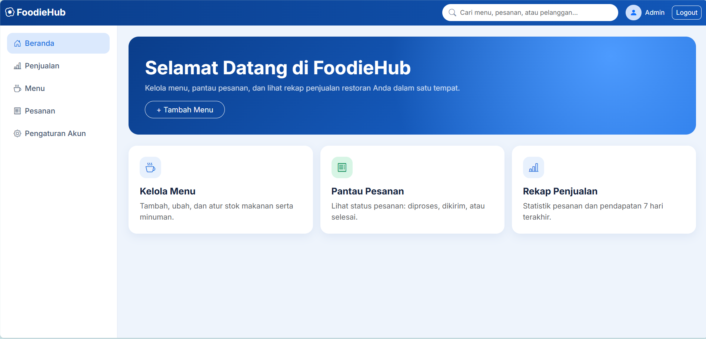
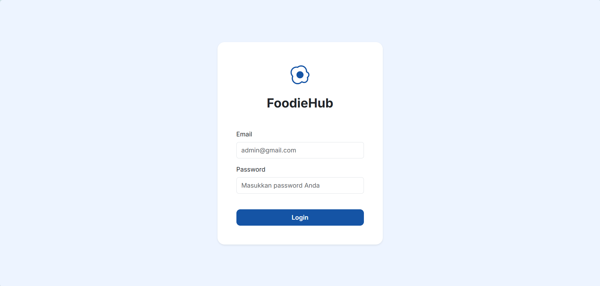
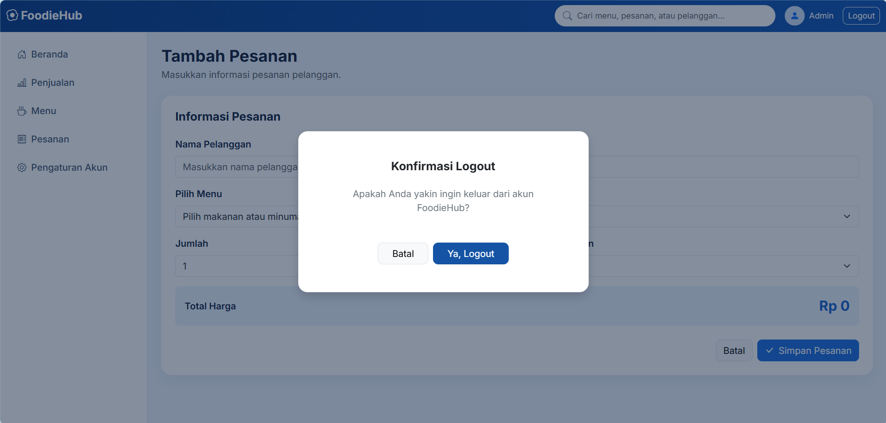
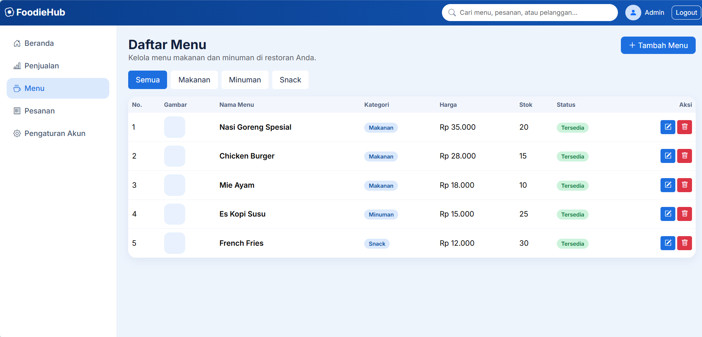
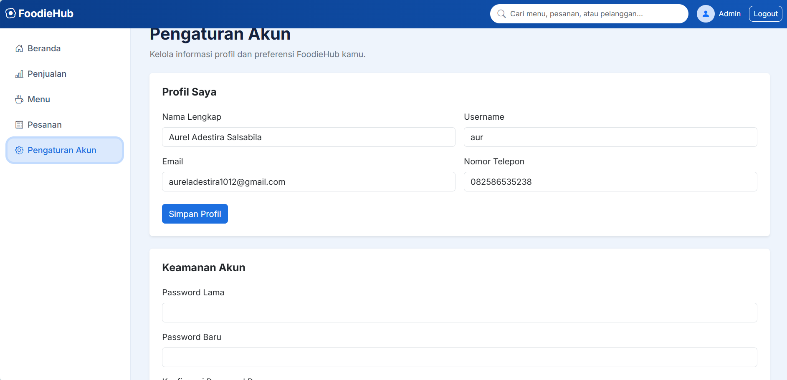
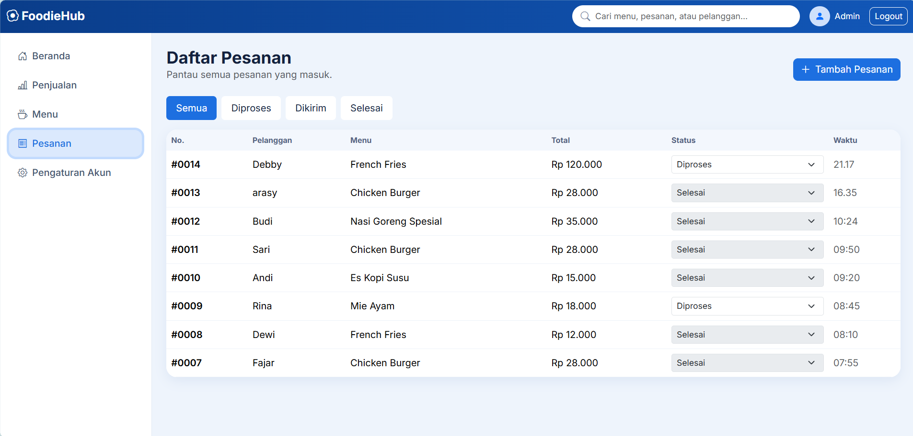
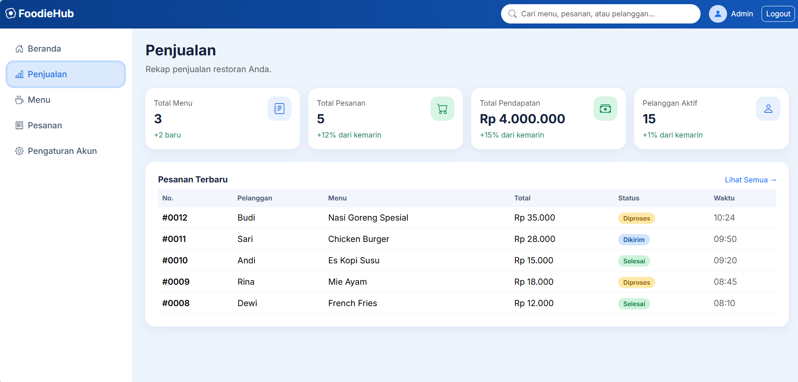
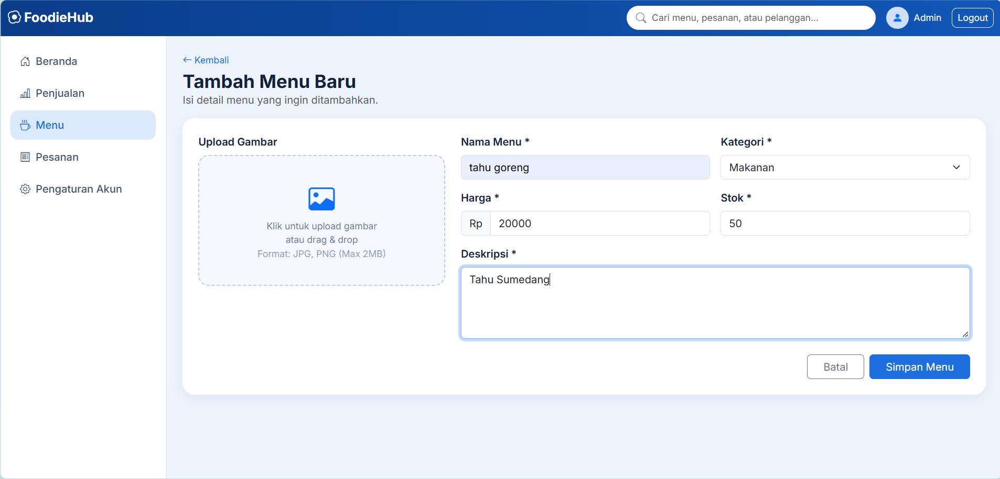
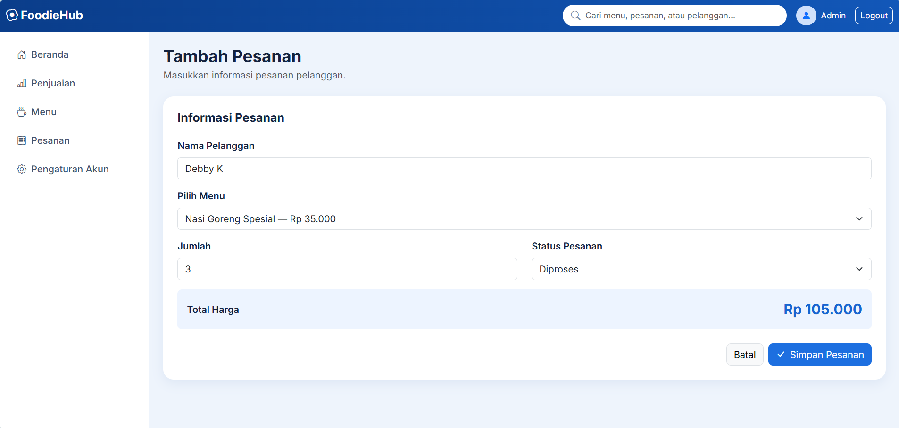

### Mobile
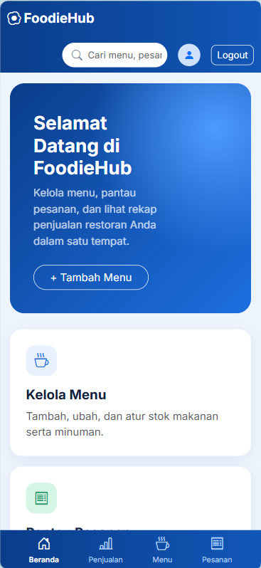
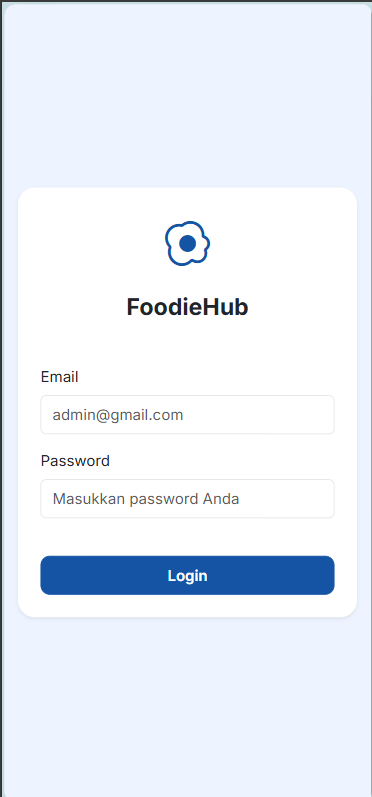
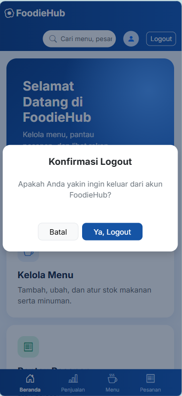
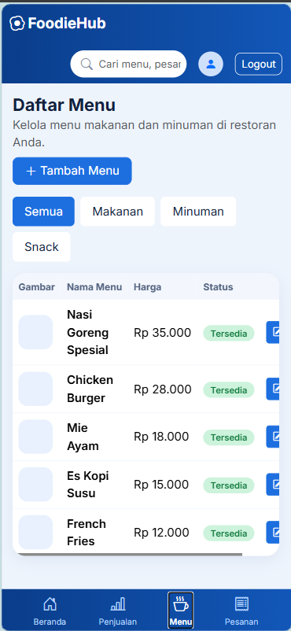
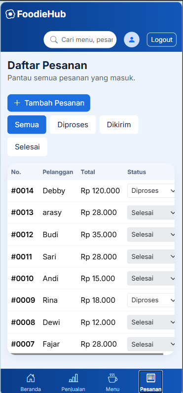
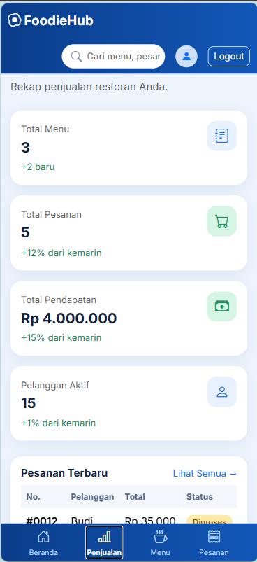
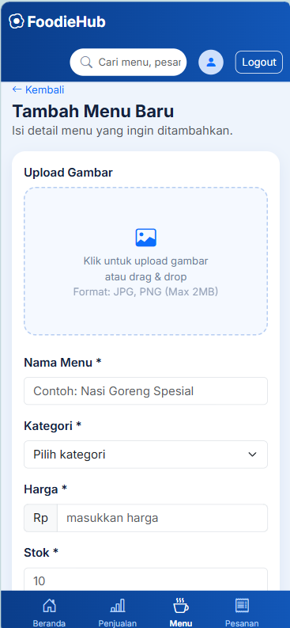
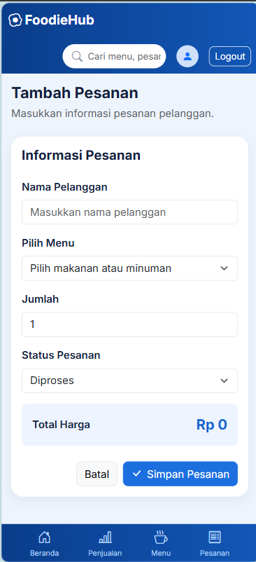
